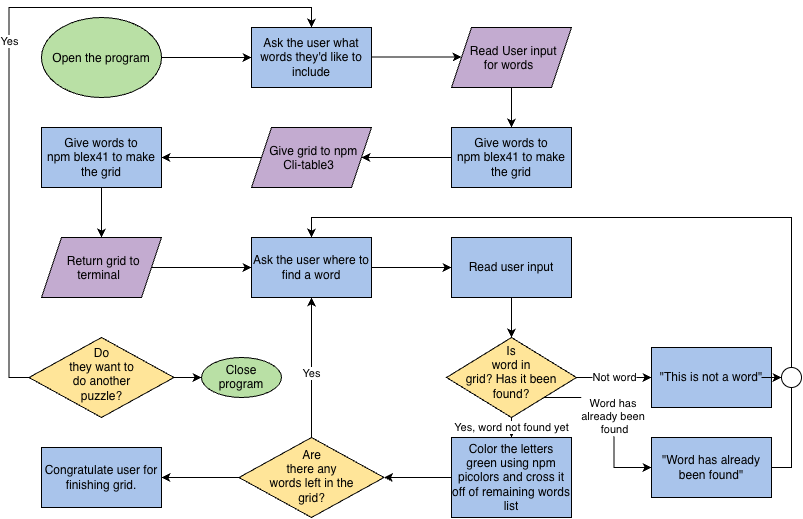

# CS 193 Final Project

Creates a word search puzzle that can be played in the terminal.

## The Problem

I enjoy doing word searches, but I find that most formats online aren't really intuitive (besides Sporcle which I have to wait for others to make the ones I want). I want a way to make my own word searches and also be able to make custom word lists that will give me a playable format not just an image.

## How It Works

A paragraph or a few bullets explaining what the software does at a
high level. If you have a diagram, embed it here:



## Tech Stack

- **Language:** Java
- **Libraries:** npm @blex41/word-search, Cli-table3, picolors
- **External tools:** JSON

## Setup

Step-by-step: how does someone who just cloned your repo get it
running?

```bash
git clone https://github.com/ewuerthele/CS193-Final-Project
cd CS193-Final-Project
./install.sh   # or whatever
```

## Usage

How to actually run the thing, with examples.
TBD
```bash
./backup.sh ~/Documents
```

## Roadmap

Features you haven't built yet but plan to (pull these from your
"Schedule" quadrant in the Eisenhower Matrix).

- [ ] Allow users to save their custom lists so they can make new puzzles if they want
- [ ] Create a custom color for the grid
- [ ] Have a stopwatch
- [ ] Create a time limit mode
- [ ] Allow for customizable grid size
- [ ] Create a setting where users select whether they want words to overlap or not
- [ ] Create links/codes to share an exact puzzle with others to compare times
- [ ] Make it into a website instead of just the terminal
- [ ] Have a daily puzzle
- [ ] Create a version like GeoEarthling’s Search and Reveal quizzes on Sporcle, where only one word can be found in each of the 9 boxes (one box getting added after finding each word)
- [ ] Create an answering method for this where user just has to input the word that is now available
- [ ] Allow for customizable grid size of the search and reveal (like instead of 5x5 can have 4x4, instead of big 3x3 can have 2x4)
- [ ] Make it into a website instead of just the terminal
- [ ] Multi-directory support
